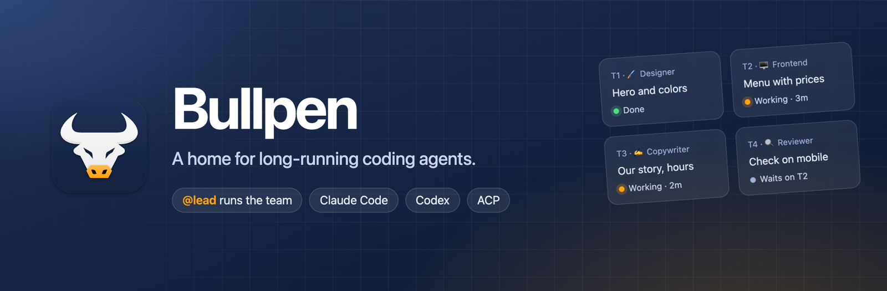
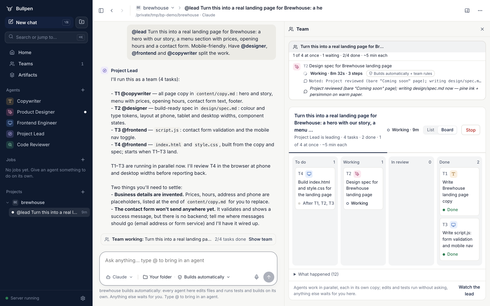
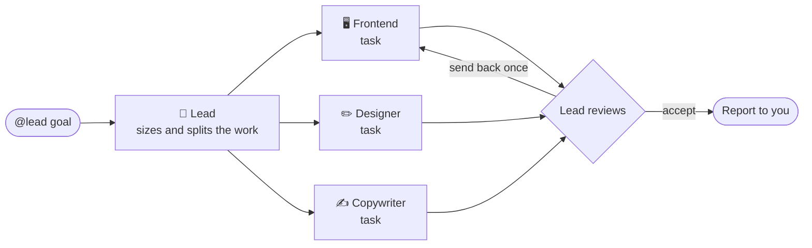
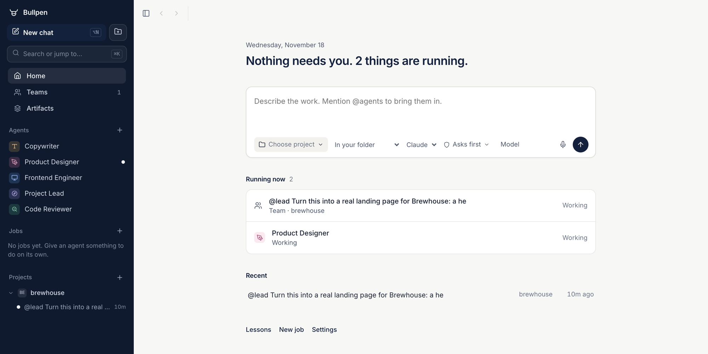

<p align="center">
  
</p>

<p align="center">
  <a href="https://github.com/BrownJ3/bullpen/releases"></a>
  <a href="https://github.com/BrownJ3/bullpen/actions/workflows/ci.yml"></a>
  
  
  <a href="LICENSE"></a>
</p>

<p align="center">
  Keep a bench of AI specialists that remember their work.<br>
  Call them into any project with an <code>@mention</code>, or hand a goal to a lead and watch a team build it.
</p>

<p align="center">
  <a href="#install"><b>Install</b></a> ·
  <a href="#getting-started"><b>Getting started</b></a> ·
  <a href="#features"><b>Features</b></a> ·
  <a href="#reference"><b>Reference</b></a> ·
  <a href="#development"><b>Development</b></a>
</p>

<br>

<p align="center">
  
</p>

## Install

**macOS and Linux**

```bash
curl -fsSL https://raw.githubusercontent.com/BrownJ3/bullpen/main/install.sh | sh
```

**Windows** (PowerShell; needs [Git](https://git-scm.com/download/win))

```powershell
irm https://raw.githubusercontent.com/BrownJ3/bullpen/main/install.ps1 | iex
```

That's it. Bullpen installs to `~/.bullpen`, starts when you sign in, adds a `bullpen` command and a Bullpen app (Start
menu on Windows), and opens in your browser. It brings its own Node if you don't have version 24+.

You'll need at least one engine you're already signed in to: **[Claude Code](https://docs.anthropic.com/en/docs/claude-code)**
or **[Codex](https://github.com/openai/codex)**. Gemini CLI, OpenCode, Goose and Qwen Code work too.

> **Updating:** click **Update** in the sidebar when a release is out, or run `bullpen update`.
> It waits for running agents to finish their step first.

## Getting started

| | |
|:--:|---|
| **1** | **Open Bullpen.** It finds the projects you've used with Claude Code or Codex and offers to bring them in, recent chats included. |
| **2** | **Start a chat** with **New chat** (⌥N). Pick a folder, describe the work, press Enter. Or click 🎙 and say it. |
| **3** | **Add agents** with **+** next to *Agents*. There's a gallery of 29 ready-made specialists, or make your own. |
| **4** | **Call one in** from any chat: `@reviewer look at the last change`. |
| **5** | **Hand off a goal:** `@lead build the checkout flow`, then open the Team panel (⌘⇧M). |

## Features

<table>
<tr>
<td width="50%" valign="top">

### 🧠 Agents that remember
Each agent has its own instructions, a memory file and **one ongoing conversation** that follows it into every
project. When one is busy, a spare copy picks up the next request.

</td>
<td width="50%" valign="top">

### 👥 Teams that run in parallel
`@lead` sizes the work, splits it into small tasks, runs up to **four at once**, hires more help when things are
slow, reviews every submission and reports back.

</td>
</tr>
<tr>
<td valign="top">

### ⏰ Jobs
Agents that work while you're away: nightly tests and fixes, reviewing new commits, weekly dependency checks.
You only hear about what needs you.

</td>
<td valign="top">

### 📚 Lessons
Correct an agent once ("we always …"), approve the lesson it proposes, and it follows that rule in every
project from then on.

</td>
</tr>
<tr>
<td valign="top">

### 🌿 Branches and undo
Run a chat, or each team task, in its own git worktree, then merge when you're happy. Every turn is checkpointed,
and **Undo** rewinds both the files and the conversation.

</td>
<td valign="top">

### 🧰 A full workspace
Terminal, file tree, a browser showing your project's site, and a live Team panel, all beside the chat.
Pick the model and dictate right from the message box.

</td>
</tr>
</table>

### How a team works



Tasks run about 10 minutes each, on separate files, in their own worktrees, and are merged back when accepted.
A task that runs long hands in what it has, and the lead turns the rest into follow-ups, so nothing is lost.
Slow goals get more people; usage limits pause the team until they reset; restarts resume where work left off.

<p align="center">
  
</p>

## Reference

<details>
<summary><b>Permissions</b>: what agents may do without asking</summary>
<br>

Each project has one access level, and every agent working there follows it. Change it from the chip under the
message box.

| Level | Agents may, without asking |
|---|---|
| **Ask first** (default) | Read. Everything else asks. |
| **Build automatically** | Edit files in the project; run tests, builds, linters, read-only git and the project's own scripts; start a local server, `curl` localhost and stop their own processes. |
| **Full access** | Anything. For throwaway projects. |

The rules are in [`src/team-policy.ts`](src/team-policy.ts) and tested by `node scripts/policy-test.ts`.

</details>

<details>
<summary><b>Panels and keyboard shortcuts</b></summary>
<br>

| | Shortcut | |
|---|---|---|
| Team | ⌘⇧M | Live status, list or board, log and speed |
| Files | ⌘⇧E | File tree with previews; Mention, Reveal, Open |
| Terminal | ⌃\` | Real shells that keep running when you close the page |
| Browser | ⌘⇧B | The project's site, or a live Chrome tab shared with the agent |
| Search | ⌘K | Jump to any chat, agent, project or action |
| New chat / project | ⌥N / ⌥⇧N | |
| Home / Teams | ⌘1 / ⌘2 | |
| Back / forward | ⌘[ / ⌘] | |

</details>

<details>
<summary><b>Command line</b></summary>
<br>

| Command | |
|---|---|
| `bullpen` | Open Bullpen (starts the server if needed) |
| `bullpen start` · `stop` · `status` · `logs` | Control the background service |
| `bullpen restart [--now]` | Restart; waits for running agent steps unless `--now` |
| `bullpen update` · `version` | Update to the newest release · show the version |
| `bullpen remote on [--lan]` · `ssh` · `reset` · `off` | Remote access (below) |
| `bullpen uninstall` | Remove the service and command; keeps your data |

</details>

<details>
<summary><b>Use it from your phone</b></summary>
<br>

```bash
bullpen remote on          # over Tailscale (recommended)
bullpen remote on --lan    # same Wi-Fi, unencrypted
bullpen remote ssh         # an SSH tunnel command for another computer
bullpen remote reset       # new device token: signs every other device out
```

The phone button in the sidebar shows a QR code to pair. The interface adapts to small screens.

</details>

<details>
<summary><b>Other engines (ACP)</b></summary>
<br>

Any [Agent Client Protocol](https://agentclientprotocol.com) agent works. Gemini CLI, OpenCode, Goose and Qwen Code
appear automatically when installed. Add others in `~/.bullpen/engines.json`:

```json
[{ "id": "my-agent", "name": "My Agent", "command": "my-agent", "args": ["--acp"] }]
```

</details>

<details>
<summary><b>Artifacts</b></summary>
<br>

Agents can publish HTML pages and Markdown reports (`create_artifact`), and every version is kept. You can also
import artifacts you made on claude.ai. Find them under **Artifacts** in the sidebar. Pages run sandboxed on a
separate origin.

</details>

<details>
<summary><b>Security</b></summary>
<br>

- The server listens on `127.0.0.1` only and every connection needs the token in `~/.bullpen/token`, which only you
  can read. It checks `Host` and `Origin`, so other web pages can't reach it.
- Remote devices get their own token, which `bullpen remote reset` revokes.
- Previewed sites and artifacts run sandboxed on a separate origin.
- Agents run commands as you. Keep **Ask first** unless you trust the task.

</details>

## Development

Node 24+ runs the TypeScript directly. There's no build step.

```bash
git clone https://github.com/BrownJ3/bullpen && cd bullpen
npm install
npm run server      # foreground server on 127.0.0.1:4773
```

<details>
<summary><b>How it's built</b></summary>
<br>

| | |
|---|---|
| [`src/server.ts`](src/server.ts) | Local HTTP and WebSocket server |
| [`src/store.ts`](src/store.ts) | Every change is an event in SQLite |
| [`src/orchestrator.ts`](src/orchestrator.ts) | Commands, runs, @mentions, crash recovery |
| [`src/providers/`](src/providers) | Engines: Claude Agent SDK, `codex app-server`, ACP |
| [`src/checkpoints.ts`](src/checkpoints.ts) | Per-turn snapshots in hidden git refs |
| [`src/team.ts`](src/team.ts) | The team engine; limits in [`src/limits.ts`](src/limits.ts) |
| [`ui/`](ui) | The web app: plain HTML, CSS and JavaScript |

To add an engine, implement `ProviderAdapter` from [`src/types.ts`](src/types.ts) and register it in `src/server.ts`.

</details>

<details>
<summary><b>Tests</b></summary>
<br>

Each starts its own throwaway server. The first four need no agents and run on every push, on macOS, Linux and
Windows, along with a test of the installers ([`.github/workflows/ci.yml`](.github/workflows/ci.yml)).

```bash
node scripts/policy-test.ts        # permission rules
node scripts/cli-test.ts           # the bullpen command: start, stop, restart
node scripts/worktrees-smoke.ts    # branches
node scripts/acp-smoke.ts          # ACP engine, against a mock agent
node scripts/team-smoke.ts         # teams end to end (uses real agents)
```

More in [`scripts/`](scripts).

`node scripts/bench.ts` measures whether a lead with a team beats one agent on the same goal: five goals from one
function to an eight-module library, each scored by hidden checks, with time, tokens and prompts recorded. It uses
real agents. `node scripts/bench.ts goals` lists them; `node scripts/bench.ts report` shows the results so far.

</details>

<details>
<summary><b>Releasing</b></summary>
<br>

Bump `version` in `package.json`, commit, then `git tag vX.Y.Z && git push origin main --tags`. Installs follow the
newest `v*` tag; a checkout on a branch follows its branch.

</details>

## Acknowledgments

Bullpen's design draws on [T3 Code](https://github.com/pingdotgg/t3code) by Ping.gg (event-sourced orchestration,
provider adapters, checkpoints, worktrees and the workspace layout), and on AgentOffice's delegate, review and
report loop. Bullpen is an independent implementation and isn't affiliated with either.

## License

[MIT](LICENSE)
